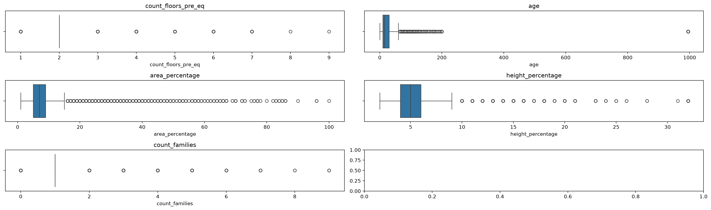
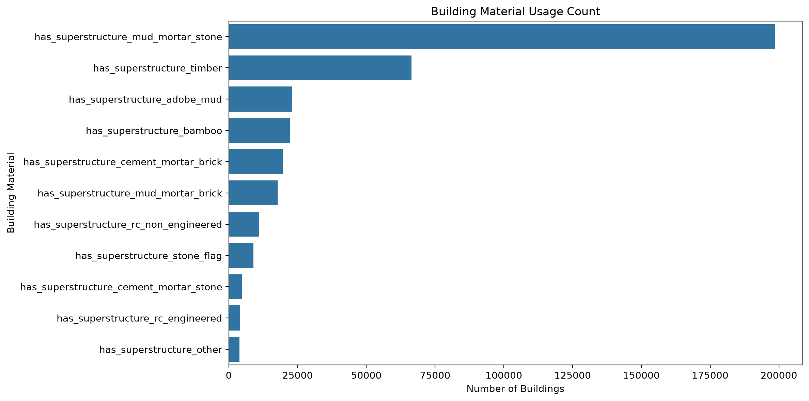
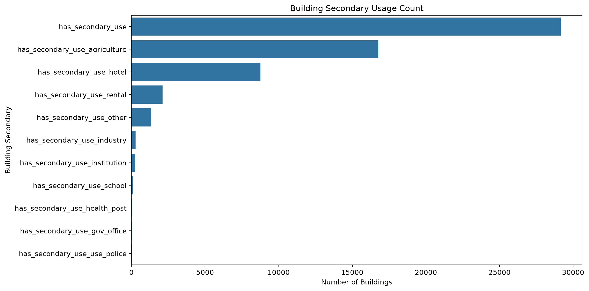
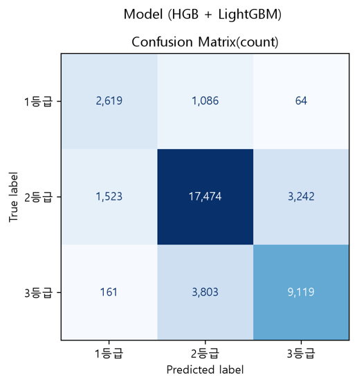
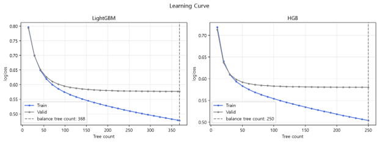
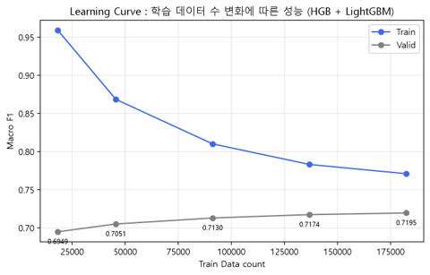
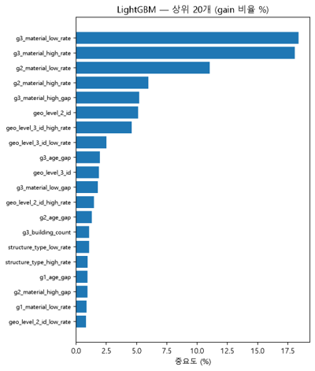
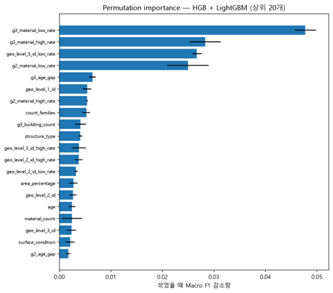

# 네팔 지진 건물 피해 예측 분류 모델   

지역별 피해 패턴과 건물 구조의 조합을 피처로 표현하고, 같은 피처 93개로 네 모델을 각각 학습한 뒤 예측 확률을 같은 비중으로 평균하는 soft voting을 적용하였다.    

2~3개 모델 조합 10가지를 검증 데이터로만 비교해 *HGB + LightGBM*을 선택하였고, 조합과 트리 수를 고정한 뒤 학습·검증 85%로 재학습하여 테스트  데이터 기준 *Macro F1 0.7158, Recall 0.7296, Accuracy 0.7473*을 나타내었다.

---

## 1. 프로젝트 개요

### 1.1 프로젝트 소개

> **프로젝트 배경**

2015년 4월 25일, 네팔 카트만두 북서쪽에서 규모 7.8의 강진이 발생하였다. 이 지진은 인접국인 인도, 중국, 방글라데시에도 영향을 미쳤으며, 약 9,000명의 사망자와 2만 명 이상의 부상자가 발생하였다. 이후 5월 12일에는 규모 7.3의 강진이 이어져 주택과 문화재 등 다수의 건축물이 붕괴되거나 파손되었다.

특히 네팔에서는 돌과 벽돌을 진흙 모르타르로 쌓아 올린 건물이 많았으며, 내진 성능이 부족한 구조와 취약한 시공 방식이 피해를 키운 원인 중 하나로 볼 수 있다. 네팔은 1994년 국가건축기준(NBC 105)을 제정하고 2020년 개정까지 거쳤으나, 일부 도시 조사에서 설계 단계 준수율이 2.63%에 그치는 등 실제 이행은 미흡한 것으로 보고된다. 이는 일본에서 1981년과 2000년 기준 개정 이후 건축 시기별 붕괴율이 뚜렷하게 갈린 것과 대비된다. 따라서 건물의 피해 정도는 지진의 규모뿐만 아니라 건물의 위치, 구조, 건축 재료, 노후도 등 다양한 특성과 관련이 있을 수 있다.

> **프로젝트 목표**

본 프로젝트는 2015년 네팔 대지진 당시 수집된 건물의 소재 지역 구분, 구조, 건축 재료 등 특성 데이터를 활용하여 건물의 지진 피해 등급을 분류하고 예측하고자 한다. 또한 등급별 예측 성능과 주요 특성을 파악하고, 등급별 데이터 불균형과 심한 피해를 실제보다 낮은 등급으로 예측하는 오류도 함께 검토하고자 한다.

- 지진 직후에는 어떤 건물이 크게 무너졌는지 빠르게 파악해야 구조 인력과 복구 자원을 효율적으로 배분할 수 있다. 하지만 수십만 채를 모두 현장 조사하기는 현실적으로 어렵다.

- 건물의 층수·연식·구조·재료·위치처럼 미리 알 수 있는 정보만으로 건물의 피해 정도를 추정할 수 있다면, 건물 피해의 최소화를 위한 우선순위를 정하는 데 도움이 됩니다.

분석 단위는 건물 한 동이고, 타깃은 원 데이터의 `damage_grade`(1·2·3)이다.  
  
표본이 적은 등급도 균형 있게 평가하기 위해 등급별 F1에 같은 비중을 두는 `Macro F1`, `Recall`을 주 지표로 사용한다.

| 평가 지표 | 사용 목적 |
|---|---|
|`Macro F1` | 등급별 F1의 단순 평균 · 모델과 조합 선택의 기준 <br> 본 프로젝트에서 **주요 지표**로 사용|
|`Accuracy` | 전체 정답률 · 다수 등급의 영향이 크다. |
|`Precision` | 각 등급으로 예측한 건물 중 실제로 맞은 비율의 평균 |
|`Recall` | 각 등급의 실제 건물 중 모델이 찾아낸 비율의 평균 <br> 본 프로젝트에서 **보조지표**로 사용           |

이를 통해 지진 피해 위험이 높은 건물의 점검과 내진 보강 우선순위를 결정하는 데 참고할 기초 자료를 마련할 수 있을 것이다. 

다만 본 분석은 2015년 단일 지진 사례를 바탕으로 하므로, 다른 지역이나 미래 지진에 적용하기 위해서는 지진 강도와 지반 조건 등 추가적인 요인을 고려한 검증이 필요하다.

### 1.2 프로젝트 정보

| 항목 | 내용 |
|---|---|
| 프로젝트 명 | 2015년 네팔 지진 건물 피해 등급(1·2·3) 분류 |
| 프로젝트 기간 |2026.10.12 ~ 2026.10.19 |
| 프로젝트 유형 |  팀 프로젝트 |
| 사용 데이터 | nepal_building_damage.csv · 260,601행 × 40열 |
| 데이터 출처 | [DrivenData - Richter's Predictor: Modeling Earthquake Damage](https://www.drivendata.org/competitions/57/nepal-earthquake/page/136/) |
| 데이터 분할 | 학습 182,420 / 검증 39,090 / 테스트 39,091 · 7:1.5:1.5 분할 · `random_state=42` |
| 비교 모델 | ExtraTrees / HistGradientBoosting(HGB) / XGBoost / LightGBM |
| 평가 지표 | Macro F1(주 지표) / Accuracy / Precision / Recall(보조 지표) |
| 최종 선택 | **HGB + LightGBM** soft voting / 검증 Macro F1 0.7195 / 테스트 Macro F1 0.7158 |
| 주요 기술 | Python, pandas, numpy, scikit-learn, lightgbm, xgboost, shap, matplotlib, Streamlit |

### 1.3 주요 성과

- 검증 데이터에서 나타난 최대 성능의 단일 모델은 *LightGBM* (Macro F1 0.7187, Recall 0.7277)이었다.  
  
- Soft Voting을 사용하여 선택한 *HGB + LightGBM* 조합은 0.7195로 단일 모델보다 미세하게 높았다.  
  
- Soft Voting을 통해 ExtraTrees / HistGradientBoosting(HGB) / XGBoost / LightGBM 모델 중 2~3개의 모델을 조합한 F1-score는 0.7161에서 0.7195 사이로 나타났다.

| 구분 | Macro F1 |Recall| 설명 |
|---|---|---|---|
| 단일 모델 최대 (검증) | 0.7187 |0.7277| LightGBM (단일 모델 예측) |
| 선택 조합 (검증) | 0.7195 | 0.7296|HGB + LightGBM (Soft Voting) |
| 최종 테스트 | 0.7158 | 0.7259|조합·트리 수 고정 후 85% 재학습, 1회 평가 |

테스트 데이터의 성능 F1-score는 1등급 0.6489, 2등급 0.7836, 3등급 0.7150이다.  
  
가장 많은 오류는 **실제 3등급을 2등급으로 예측**한 3,803건이고, 그다음은 **실제 2등급을 3등급으로 예측**한 3,242건이다.  
  
피해가 큰 등급을 낮은 등급으로 예측하는 과소 예측이 전체 오류의 상당 부분을 차지할 수 있다.

---

<br>

## 2. 프로젝트 구조

```text
nepal-earthquake-damage/
├── README.md
├── pyproject.toml
├── uv.lock
├── .python-version
├── .gitignore
├── requirements.txt
│
├── data/
│   └── raw/
│       ├── nepal_building_damage.csv
│       └── nepal_building_damage_dictionary.xlsx
│
├── notebooks/
│   ├── 01_EDA.ipynb
│   ├── 02_baseline.ipynb
│   ├── 03-01_modeling_exp1_기존9개.ipynb
│   ├── 03-02_modeling_exp2_9개_추가.ipynb
│   ├── exp3_튜터지역정보.ipynb
│   ├── exp3_튜터지역정보_튜닝.ipynb
│   └── exp3_softvoting_1.ipynb
│
├── models/
│   ├── final_model.joblib
│   └── test_metrics.json
│
├── figures/
├── reports/
│   └── 지진피해_머신러닝_예측보고서.docx
│
├── assets/
├── .streamlit/config.toml
├── app.py
├── features.py
├── train_model.py
└── results.py
```

**주요 디렉터리 및 파일 설명**

| 파일 / 디렉터리 | 설명 |
|---|---|
| `pyproject.toml`, `uv.lock` | 프로젝트 의존성 및 버전 고정 (uv) |
| `requirements.txt` | Streamlit 앱 실행에 필요한 최소 패키지 (pip 사용 시) |
| `data/raw/` | 원본 데이터와 컬럼 정의서 |
| `notebooks/` | EDA, 베이스라인, 파생변수 실험, 튜닝, soft voting 노트북 |
| `models/` | 학습된 최종 모델과 테스트 지표 |
| `figures/` | README에 쓰인 분석 결과 이미지 |
| `reports/` | 프로젝트 보고서 |
| `app.py` | Streamlit 대시보드 |

---

<br>

## 3. 설치 및 실행 방법

본 프로젝트는 **uv + Jupyter Notebook** 환경을 기반으로 수행되었습니다.

### 3.1 실행 환경

- Windows · Python 3.13
- uv
- Jupyter Notebook 또는 VS Code
- Streamlit

### 3.2 Repository 다운로드

```bash
git clone <repository-url>
cd nepal-earthquake-damage
```

### 3.3 uv 설치 및 환경 구성

[uv 공식 설치 안내](https://docs.astral.sh/uv/getting-started/installation/)를 참고하여 uv를 설치한 뒤, 프로젝트 의존성을 설치합니다.

```bash
uv sync
```

### 3.4 데이터 준비

1. [DrivenData 대회 페이지](https://www.drivendata.org/competitions/57/nepal-earthquake/page/136/)에서 데이터를 내려받습니다.
2. `nepal_building_damage.csv`를 `data/raw/` 디렉터리에 저장합니다.

### 3.5 Jupyter Notebook 실행

**VS Code 사용 시**

1. VS Code에서 프로젝트 폴더를 엽니다.
2. 실행할 `.ipynb` 파일을 엽니다.
3. 우측 상단의 **Select Kernel**을 클릭합니다.
4. 프로젝트의 `.venv`에 있는 Python 환경을 선택합니다.
5. Notebook 셀을 순서대로 실행합니다.

### 3.6 분석 및 모델링 실행 순서

| 순서 | 파일 | 주요 내용 |
|---|---|---|
| 1 | `01_EDA.ipynb` | 데이터 탐색 및 EDA |
| 2 | `02_baseline.ipynb` | 베이스라인 모델 비교 |
| 3 | `03-01_modeling_exp1_기존9개.ipynb` | 실험 1) 기존 파생변수 16개 추가 |
| 4 | `03-02_modeling_exp2_9개_추가.ipynb` | 실험 2) 파생변수 7개 추가 |
| 5 | `exp3_지역정보.ipynb` | 실험 3) 지역 정보 파생변수 32개 추가 |
| 6 | `exp3_지역정보_튜닝.ipynb` | 설정한 가중치로 랜덤서치 진행 |
| 7 | `exp3_softvoting.ipynb` | 실험 ③ Soft Voting |

**재현 절차**

| 단계 | 내용 |
|---|---|
| 1 데이터 | nepal_building_damage.csv를 같은 폴더에 두고 위에서부터 차례로 실행 |
| 2 분할 | random_state=42 층화 분할로 70 / 15 / 15 복원 |
| 3 피처 | make_features로 93개 열 생성 · 타깃 인코딩은 학습 내부 5폴드 OOF |
| 4 학습 | class_weight {1.9, 1.0, 1.3}로 네 모델 학습 · 조기 종료로 트리 수 결정 |
| 5 선택 | 검증 데이터에서 10개 조합 비교 후 Macro F1 1위 조합 선택 |
| 6 재학습 | 학습+검증 85%로 선택 모델만 트리 수를 고정해 재학습 |
| 7 평가 | 70% 학습 모델 기준 |

| 항목 | 기록 |
|---|---|
| 난수 시드 | 42 (분할, 모델, 폴드, 샘플링 공통) |
| 주요 라이브러리 | pandas, numpy, scikit-learn, lightgbm, xgboost, shap, matplotlib |
| 실행 환경 | Windows · Python 3.13 |
| 학습 시간 | LightGBM 14초 · XGBoost 28초 · HGB 130초 · ExtraTrees 7초 |
| 추가 계산 시간 | permutation importance 58초 · 학습량별 재학습 12~38초 |

### 3.7 Streamlit 실행

```bash
uv run python train_model.py
uv run streamlit run app.py
```

실행 후 브라우저에서 `http://localhost:8501`로 접속합니다. 별도 웹 배포 없이 로컬 환경에서 실행할 수 있습니다.

---

<br>

## 4. 기술 스택

| 구분 | 사용 기술 |
|---|---|
| Language | Python 3.13 |
| Environment & Package Management | uv |
| Data Processing | pandas, numpy |
| Visualization | matplotlib |
| Machine Learning | scikit-learn, lightgbm, xgboost |
| Imbalanced Learning | class_weight |
| Model Interpretation | permutation importance, SHAP |
| Dashboard | Streamlit |
| Development | Jupyter Notebook, VS Code, Git |

---

<br>

## 5. 데이터셋

### 5.1 데이터 개요

- 분석에는 단일 CSV 파일 `nepal_building_damage.csv`를 사용하였다.  불러온 원본 크기는 **260,601행 × 40열**이다. 

- 이 중 `building_id`는 **식별자**, `damage_grade`는 **타깃변수**이므로 두 변수를 제외하고 나머지 38개 열을 원본 설명 변수로 사용하였다. 

| 구분 | 건수 | 비율 | 열 수 | 용도 |
|---|---|---|---|---|
| 원본 | 260,601 | 100% | 40 | `building_id`와 `damage_grade` 포함 |
| 학습 | 182,420 | 70% | 38 | 모델 학습 |
| 검증 | 39,090 | 15% | 38 | 조기 종료, 하이퍼 파라미터 조합 선택 |
| 테스트 | 39,091 | 15% | 38 | 최종 1회 평가 |

- 분할은 train_test_split을 두 번 적용하였다. 먼저 전체에서 30%를 떼어내고, 그 30%를 다시 절반으로 나누어 검증과 테스트를 만들었다.    
- 두 단계 모두 damage_grade 비율을 유지하는 데이터 분할이며 재현성 구현을 위해 `random_state를 42`로 적용하였다.

### 5.2 데이터 특징

**타깃변수(`damage_grade`) 비율**

| 등급 | 검증 건수 | 검증 비율 | 테스트 건수 | 테스트 비율 |
|---|---|---|---|---|
| 1등급 | 3,768 | 9.64% | 3,769 | 9.64% |
| 2등급 | 22,239 | 56.89% | 22,239 | 56.89% |
| 3등급 | 13,083 | 33.47% | 13,083 | 33.47% |
| 합계 | 39,090 | 100% | 39,091 | 100% |

**[Target Distribution]**


- 타깃변수의 클래스 중 grade2가 50%를 차지하여 전체 정확도만 높이는 방향으로 학습하면,   
1등급이 거의 예측하지 못하는 오류가 발생할 가능성이 있다.

- 따라서 클래스 불균형 처리를 위해 SMOTE, SMOTENC, Under Sampling, Class Weight을 비교해본다.

---

<br>

## 6. 데이터 분석 및 전처리

### 6.1 탐색적 데이터 분석 (EDA)

**주요 분석 내용**

- 데이터 구조 및 변수 유형 확인
- 결측치 및 중복 데이터 확인
- 주요 변수의 분포 확인
- Target 클래스 분포 분석
- 변수 간 관계 분석

**분석 결과 시각화**

**[이상치 파악]**



- 이상치 판단 중에 특이점으로 건물의 연식 컬럼명인 `age` : **995**라는 혼자 범위가 큰 데이터가 존재한다.

- 그 외의 컬럼은 모두 정상적인 수치로 간주하였다.

**[건축 사용 자재 수]** 
-  건축에 사용한 자재 중 머드_모르타르를 사용한 수가 가장 많았다.

**[3등급 위험분류_건축자재]**


- 2차적 사용용도로 사용한 건물 중 농업용도로 사용한 건물이 가장 많았으며, 호텔이 그 뒤를 이었다. 


### 6.2 데이터 전처리

**데이터 누수 방지**

- **데이터 누수(Data Leakage)** 는 모델이 학습하는 과정에서 실제 예측 시에는 알 수 없는 정보를 미리 사용하는 문제를 의미한다. 이러한 문제가 발생하면 모델의 성능이 실제보다 높게 평가될 수 있으므로 이를 방지하기 위한 처리를 진행하였다.

- 먼저 지역별 평균 건물 나이와 건물의 특성은 학습 데이터만을 이용하여 계산하였다. 이후 계산된 지역별 통계값을 검증 데이터와 테스트 데이터에도 동일하게 적용하였다. 학습 데이터에 존재하지 않는 새로운 지역은 전체 평균값으로 대체하였다.

- 다음으로 지역별 피해 등급 비율은 실제 피해 등급을 이용하여 계산하기 때문에 데이터 누수가 발생할 가능성이 있다. 이를 방지하기 위해 **OOF(Out-of-Fold) 방식**을 적용하였다. 

- 마지막으로 문자형 변수는 수치형 변수로 인코딩하였다. 

- 또한 학습 데이터와 검증 데이터의 변수 구성이 동일한지 확인하여 모델 학습과 평가 과정에서 오류가 발생하지 않도록 하였다.

**실험별 파생변수 요약**

모델은 세 실험 모두 같은 설정의 **LightGBM(n_estimators=800, learning_rate=0.04, num_leaves=31)** 으로 선정하였다.

- 파생변수 생성은  범주형 변수에 대해 관계파악이 목적인 카이제곱 검정을 통해 유의한 변수들을 중점적으로 변수들을 생성하였다.  

<br>

> **실험 1) 기존 파생변수 16개 추가 (원본 38개 -> 54개)**

| 변수명 | 설명 | 타입 |
|---|---|---|
| `is_995` | 건물 나이가 995(이상값)인지 여부 | int (0/1) |
| `height_area_ratio` | 높이 / 면적 (면적 clip(lower=1)) | float |
| `material_count` | 사용한 구조 재료 개수 | int |
| `secondary_use_count` | 사용한 부가용도 개수 | int |
| `height_per_floor` | 높이 / 층 수 (층 수 clip(lower=1)) | float |
| `rc_count` `mud_count` | 철근콘크리트 계열, 흙 계열 재료 사용 개수 | int |
| `has_rc` `has_mud` | 철근콘크리트, 흙 재료 사용 여부 | int(0/1) |
| `foundation_roof`<br> `ground_other_floor` <br> `foundation_ground` <br> `surface_condition` | 기초_지붕 조합<br>1층 바닥_상부층 바닥 조합<br>기초_1층 바닥 조합<br>지표면 상태_1층 바닥 조합 | object |
| `geo_level_1/2/3_id_age_mean` | 지역별 평균 나이 (학습 데이터 기준, 995 제외) | float |

**결과:** 변수 54개, **검증 Macro F1 기본 0.7084 → 종속변수 등급별 가중치 조정 후 0.7182**

<br>

> **실험 2) 실험 1 + 파생변수 7개 추가 (54개 -> 61개)**

| 변수명 | 설명 | 타입 |
|---|---|---|
| `cement_mortar_count` | 시멘트 계열 재료(시멘트 모르타르 돌·벽돌) 사용 개수 | int |
| `wood_bamboo_count` | 목재, 대나무 사용 개수 | int |
| `n_weak_material` | 취약 재료(흙벽돌, 흙 모르타르 돌·벽돌, 판석) 사용 개수 | int |
| `material_group` | 대표 재료 그룹 (RC > 시멘트 > 흙·돌 > 나무 > 기타 순서로 우선) | object |
| `structure_type` | 기초_지붕_1층 바닥 조합 | object |
| `floor_band` | 층수 구간 (1F / 2F / 3F+) | object |
| `weak_age` | 흙·돌 건물의 나이 (그 외 건물과 995는 0) | int |

**결과:** 변수 61개, **검증 Macro F1 기본 0.7085 → 종속변수 등급별 가중치 조정 후 0.7178**

<br>

> **실험 3) 실험 2 + 지역 정보 파생변수 32개 추가 (61개 -> 92개)**

| 변수명 | 설명 | 타입 |
|---|---|---|
| `g1/g2/g3_building_count` | 지역별 건물 수 | float |
| `g1/g2/g3_weak_ratio` | 지역별 취약 재료 건물 비율 | float |
| `g1/g2/g3_rc_ratio` | 지역별 RC 건물 비율 | float |
| `geo_level_1/2/3_id_low_rate`<br>`geo_level_1/2/3_id_high_rate` | 지역별 1등급 비율, 3등급 비율 | float |
| `material_group_low_rate`<br>`material_group_high_rate` | 대표 재료 그룹별 1등급, 3등급 비율 | float |
| `structure_type_low_rate`<br>`structure_type_high_rate` | 구조 유형별 1등급, 3등급 비율 | float |
| `g1/g2/g3_material_low_rate`<br>`g1/g2/g3_material_high_rate` | 지역×재료 그룹별 1등급, 3등급 비율 | float |
| `g2/g3_material_high_gap`<br>`g2/g3_material_low_gap` | 지역×재료 피해율 - 같은 재료 전체 피해율 | float |

**결과:** 변수 93개, **검증 Macro F1 기본 0.7067 -> 종속변수 등급별 가중치 조정 후 0.7184**

트리 386개로 가장 빨리 수렴하여 검증 데이터의 성능은 Macro F1 0.7184 (Accuracy 0.7467)로 세 실험 중에 가장 높은 성능을 보였다.    
따라서 **실험 3에 사용한 변수들을 최종 변수로 가정하였다.**

---

<br>

## 7. 머신러닝 모델링

### 7.1 Baseline 모델

**사용 모델:** LightGBM

| 모델 | F1-score(macro) | Accuracy | Recall |
|---|---|---|---|
| CatBoost | 0.6593 | 0.7245 | 0.6275 |
| XGBoost | 0.6551 | 0.7201 | 0.6248 |
| Random Forest | 0.6503 | 0.7099 | 0.6260 |
| LightGBM | 0.6416 | 0.7108 | 0.6108 |
| Decision Tree | 0.6090 | 0.6592 | 0.6110 |
| GBM | 0.6010 | 0.6828 | 0.5710 |
| Logistic Regression | 0.4646 | 0.5909 | 0.4571 |

**선택 이유**

- 베이스라인은 F1-score를 기준으로 CatBoost, XGBoost, Random Forest, LightGBM 순으로 높게 나타났다. 

- 특히 앙상블 계열의 모델이 높게 나타났으며, 해당 데이터에서 건물의 특성, 건축재료, 지역적 특성 등의 비선형적 관계와 관련이 있을 가능성이 존재한다. 

- CatBoost가 가장 높은 성능을 보였으나, 본 프로젝트에서는 학습 효율성과 파생변수 추가 및 하이퍼파라미터 튜닝의 편의성을 고려하여 LightGBM을 최종 베이스라인 모델로 선정하였다.


### 7.2 불균형 데이터 처리

**적용한 방법**   

- Class Weight

**선택 이유**

- 불균형 처리는 타깃변수인 피해 등급별로 데이터 수의 차이로 인해 모델이 다수 클래스에 집중되어 예측하는 문제를 완화하기 위해 수행하였다. 

- 현재 데이터는 피해 등급 중 2등급의 비율이 가장 높고 1등급의 비율이 상대적으로 낮은 불균형 구조를 가지고 있다. 이러한 데이터 불균형은 모델이 다수 클래스인 2등급을 중심으로 학습하게 하여 소수 클래스의 예측 성능을 저하시킬 가능성이 있다. 

- 따라서 본 프로젝트에서는 클래스 가중치(Class Weight)를 적용하여 데이터 수가 적은 클래스에 상대적으로 높은 가중치를 부여하였다. 이를 통해 모델이 다수 클래스뿐만 아니라 소수 클래스의 특성도 충분히 학습할 수 있도록 하였다.

**처리 전후 비교**

| 실험 | 변수 수 | 가중치 미조정 F1 | 가중치 조정 후 F1 | 최적 가중치 (1/2/3) |
|---|---|---|---|---|
| ① 기존 파생변수 | 54 | 0.7084 | 0.7182 | 1.7 / 1.0 / 1.5 |
| ① ② + 추가 변수 | 61 | 0.7085 | 0.7178 | 1.8 / 1.0 / 1.5 |
| ② ③ + 지역 정보 | 93 | 0.7067 | 0.7184 | 1.8 / 1.0 / 1.3 |


### 7.3 모델 비교 및 성능 개선

**세 실험 비교**

| 실험 | 변수 수 | 가중치 미조정 F1 | 가중치 조정 후 F1 | 최적 가중치 (1/2/3) |
|---|---|---|---|---|
| ① 기존 파생변수 | 54 | 0.7084 | 0.7182 | 1.7 / 1.0 / 1.5 |
| ① ② + 추가 변수 | 61 | 0.7085 | 0.7178 | 1.8 / 1.0 / 1.5 |
| ② ③ + 지역 정보 | 92 | 0.7067 | 0.7184 | 1.8 / 1.0 / 1.3 |

- 타깃변수의 클래스별 가중치 조정 후 검증 데이터의 F1-score는 모두 상승한 것을 볼 수 있다.
- 하지만 추가 변수들을 한번에 넣어 학습을 했으므로 어떤 변수가 효과가 나타났는지는 자세히 알 수 없다.

**설정한 가중치로 랜덤서치 진행 - 하이퍼파라미터 튜닝 결과**

- 실험 ③ (변수 93개)의 LightGBM 모델에 대해 하이퍼파라미터를 랜덤서치로 튜닝을 진행했다. 

- 하이퍼파라미터 선택은 검증 데이터로만 진행하였다.

<br>

*1) 탐색 방법과 선택된 설정*

후보 값 조합 중 30개를 무작위로 뽑아 재현성 유지를 위해 `SEED=42`로 학습하였고,    

타깃변수에 가중치 조정 후 검증 Macro F1이 가장 높은 설정으로 모델을 선정하였다.

| 하이퍼파라미터 | 후보 값 | 튜닝 전 | 튜닝 시도 5번 |
|---|---|---|---|
| `learning_rate` | 0.03 ~ 0.08 | 0.04 | 0.03 |
| `num_leaves` | 31 ~ 255 | 31 | 127 |
| `min_child_samples` | 20 ~ 150 | 40 | 40 |
| `subsample` | 0.7 ~ 1.0 | 0.85 | 0.85 |
| `colsample_bytree` | 0.5 ~ 0.85 | 0.85 | 0.7 |
| `reg_lambda` | 0 ~ 10 | 2.0 | 10 |
| `cat_smooth` | 10 ~ 60 | 30 | 60 |
| `cat_l2` | 1 ~ 30 | 10 (기본값) | 30 |
| `min_data_per_group` | 50 ~ 200 | 100 (기본값) | 200 |
| 트리 수 | 최대 3,000, 조기 종료 100 | 386 | 526 |
| 가중치 (1/2/3등급) | 1등급 0.8~2.4, 3등급 0.7~2.0 | 1.8 / 1.0 / 1.3 | 1.9 / 1.0 / 1.3 |

**결과:** 30번의 시도 중에 시도 5가 선택되었다. **검증 Macro F1 0.7184 -> 0.7207 (+0.0023)**.

*2) 탐색 결과 상위 10개 (검증 데이터)*

| 시도 | 조정 후 F1 | 기본 F1 | 트리 수 | 가중치 (1/2/3) | lr | leaves | cat_smooth |
|---|---|---|---|---|---|---|---|
| **5** | **0.7207** | **0.7097** | **526** | **1.9 / 1.0 / 1.3** | **0.03** | **127** | **60** |
| 19 | 0.7197 | 0.7074 | 465 | 1.6 / 1.0 / 1.2 | 0.08 | 31 | 60 |
| 25 | 0.7195 | 0.7083 | 488 | 1.7 / 1.0 / 1.2 | 0.08 | 31 | 60 |
| 15 | 0.7195 | 0.7079 | 715 | 2.0 / 1.0 / 1.4 | 0.05 | 31 | 60 |
| 22 | 0.7193 | 0.7075 | 330 | 1.8 / 1.0 / 1.2 | 0.05 | 63 | 60 |
| 2 | 0.7192 | 0.7087 | 646 | 1.9 / 1.0 / 1.3 | 0.03 | 63 | 60 |
| 1 | 0.7192 | 0.7077 | 672 | 1.6 / 1.0 / 1.3 | 0.03 | 63 | 60 |
| 11 | 0.7190 | 0.7091 | 301 | 1.7 / 1.0 / 1.3 | 0.03 | 255 | 60 |
| 24 | 0.7190 | 0.7093 | 278 | 1.8 / 1.0 / 1.3 | 0.03 | 255 | 60 |
| 4 | 0.7187 | 0.7076 | 171 | 1.6 / 1.0 / 1.4 | 0.05 | 255 | 60 |
| **튜닝 전** | **0.7184** | **0.7067** | **386** | **1.8 / 1.0 / 1.3** | **0.04** | **31** | **30** |

- 30개 시도의 조정 후 검증 F1-score은 0.7150~0.7207 정도로 나타났다.
- 상위 10개의 검증 F1-score는 0.7187~0.7207 정도로 나타났다. 
- 트리 100개 내에서 조기종료된 시도는 대부분 0.7150~0.7163으로 나타나 하위로 나타났다.

*3) 최종 테스트 결과 (학습+검증 85%로 재학습)*

| 지표 (테스트) | 튜닝 전 | 튜닝 시도 5 | 차이 |
|---|---|---|---|
| **Macro F1** | **0.7137** | **0.7155** | **+0.0018** |
| Accuracy | 0.7467 | 0.7476 | +0.0009 |
| Precision | 0.7076 | 0.7087 | +0.0011 |
| Recall | 0.7213 | 0.7240 | +0.0027 |
| 1등급 Recall / F1 | 0.6800 / 0.6428 | 0.6859 / 0.6467 | +0.0059 / +0.0039 |
| 2등급 Recall / F1 | 0.7876 / 0.7836 | 0.7858 / 0.7836 | −0.0018 / 0.0000 |
| 3등급 Recall / F1 | 0.6964 / 0.7145 | 0.7004 / 0.7163 | +0.0040 / +0.0018 |

**혼동행렬 (튜닝 전 대비 변화)**

| 실제 / 예측 | 1등급 | 2등급 | 3등급 |
|---|---|---|---|
| 1등급 | 2,585 (+22) | 1,118 (−12) | 66 (−10) |
| 2등급 | 1,491 (+2) | 17,475 (−41) | 3,273 (+39) |
| 3등급 | 150 (−3) | 3,770 (−49) | 9,163 (+52) |

**결과:**    
- 테스트 Macro F1 0.7137 → 0.7155 (+0.0018), Accuracy 0.7467 → 0.7476.    
- 2등급의 정확도는 줄었지만, 1등급과 3등급의 정확도가 올라갔다.
- 특히 가장 중요한 3등급 예측의 정확도가 증가하였다.

<br>

**실험 ③ Soft Voting**

- 실험 ③(변수 93개)으로 LightGBM / XGBoost / HGB / ExtraTrees 4개 모델을 학습하고, 2~3개씩 묶어 예측 확률을 같은 비중으로 평균(soft voting)했다. 

- 등급 불균형은 class_weight(1.9 / 1.0 / 1.3)를 네 모델에 sample_weight로 똑같이 적용하였다. 

- 조합 선택은 검증 Macro F1, recall을 중심으로 선정하였고, 테스트는 마지막에 한 번 평가하였다.

<br>

*모델 구성*

| 모델 | 주요 하이퍼 파라미터 | 트리 수 | 학습 시간 |
|---|---|---|---|
| **LightGBM** | `objective=multiclass`, `learning_rate=0.03`, `num_leaves=127`, `min_child_samples=40`, `subsample=0.85`, `colsample_bytree=0.7`, `reg_lambda=10`, `cat_l2=30`, `min_data_per_group=200` | 368 (조기 종료) | 14초 |
| XGBoost | `objective=multi:softprob`, `learning_rate=0.05`, `max_depth=8`, `min_child_weight=5`, `subsample=0.85`, `colsample_bytree=0.7`, `reg_lambda=5`, `tree_method=hist`, `enable_categorical=True`, `max_cat_to_onehot=1` | 222 (조기 종료) | 28초 |
| **HGB (HistGradientBoosting)** | `learning_rate=0.05`, `max_leaf_nodes=63`, `min_samples_leaf=40`, `l2_regularization=5.0` | 250 | 130초 |
| ExtraTrees | `n_estimators=200`, `max_features=sqrt`, `min_samples_leaf=5` | 200 | 7초 |

<br>

*모델별 단독 성능 비교 (검증 데이터)*

| 모델 | Macro F1 | Accuracy | Precision | Recall |
|---|---|---|---|---|
| **LightGBM** | **0.7187** | **0.7493** | **0.7119** | **0.7277** |
| HGB | 0.7168 | 0.7467 | 0.7073 | 0.7294 |
| XGBoost | 0.7123 | 0.7450 | 0.7078 | 0.7186 |
| ExtraTrees | 0.7123 | 0.7474 | 0.7103 | 0.7169 |

**결과:**    
- 네 모델의 단독 모델 Macro F1의 성능은 0.7123 ~ 0.7187로 나타난다. 
- LightGBM이 가장 높고 HGB가 다음이다. 
- HGB는 Recall이 0.7294로 가장 높았으며, Precision은 0.7073으로 나타나, 건물 피해 위험 등급을 더 적극적으로 찾아내는 대신 잘못 찾아내는 특징도 보인다.


타깃변수의 클래스별 가중치 조정 후 검증 데이터의 F1-score는 모두 상승한 것을 볼 수 있다.

### 7.4 모델 성능 비교

**2~3개 모델 조합 비교 (검증)**

| 조합 | 모델 수 | Macro F1 | Accuracy | Precision | Recall |
|---|---|---|---|---|---|
| **HGB + LightGBM** | **2** | **0.7195** | **0.7495** | **0.7118** | **0.7296** |
| ExtraTrees + HGB + LightGBM | 3 | 0.7195 | 0.7506 | 0.7140 | 0.7272 |
| ExtraTrees + HGB + XGBoost | 3 | 0.7187 | 0.7501 | 0.7136 | 0.7260 |
| HGB + XGBoost + LightGBM | 3 | 0.7181 | 0.7488 | 0.7117 | 0.7266 |
| ExtraTrees + HGB | 2 | 0.7180 | 0.7494 | 0.7121 | 0.7265 |
| ExtraTrees + LightGBM | 2 | 0.7179 | 0.7501 | 0.7142 | 0.7237 |
| HGB + XGBoost | 2 | 0.7171 | 0.7477 | 0.7104 | 0.7261 |
| XGBoost + LightGBM | 2 | 0.7171 | 0.7482 | 0.7118 | 0.7242 |
| ExtraTrees + XGBoost + LightGBM | 3 | 0.7169 | 0.7489 | 0.7131 | 0.7227 |
| ExtraTrees + XGBoost | 2 | 0.7161 | 0.7490 | 0.7133 | 0.7211 |

**결과:** 
- **HGB + LightGBM**과 **ExtraTrees + HGB + LightGBM**은 Macro F1이 0.7195로 같게 나타났다.   
 하지만 보조지표인 Recalll 지표는 **HGB + LightGBM**에서 높게 나타났으므로 최종 모델을 **HGB + LightGBM**로 선정하였다. 

- 모든 조합에 **HGB**가 포함된 상위 5모델에서 HGB가 조합에 포함되어있어, HGB 모델이 성능에 일부 기여한다고 볼 가능성이 있다.

**이전 방식과 비교 (테스트 데이터)**

| 지표 (테스트) | LightGBM 튜닝 전 + 가중치 | LightGBM 튜닝 후 + 가중치 | Soft voting HGB + LightGBM |
|---|---|---|---|
| **Macro F1** | **0.7137** | **0.7155** | **0.7158** |
| Accuracy | 0.7467 | 0.7476 | 0.7473 |
| Precision | 0.7076 | 0.7087 | 0.7080 |
| Recall | 0.7213 | 0.7240 | 0.7259 |
| 1등급 Recall | 0.6800 | 0.6859 | 0.6949 |
| 2등급 Recall | 0.7876 | 0.7858 | 0.7857 |
| 3등급 Recall | 0.6964 | 0.7004 | 0.6970 |

**결과:** 테스트 Macro F1 0.7158, Accuracy 0.7473. 튜닝 후 LightGBM + 가중치(0.7155) 1등급 Recall은 0.6949로 세 방식 중 가장 높다.

---

<br>

## 8. 최종 모델 및 결과 분석

### 8.1 최종 모델 선정

- **최종 모델:** HGB + LightGBM (soft voting)

- **적용한 불균형 처리 방법:** class_weight(1.9 / 1.0 / 1.3)로 적용

- **주요 하이퍼파라미터:**
  - **LightGBM**:    
  `objective=multiclass`, `learning_rate=0.03`, `num_leaves=127`, `min_child_samples=40`, `subsample=0.85`, `colsample_bytree=0.7`, `reg_lambda=10`, `cat_l2=30`, `min_data_per_group=200`, `트리 368`

  - **HGB**:    
  `learning_rate=0.05`, `max_leaf_nodes=63`, `min_samples_leaf=40`, `l2_regularization=5.0`, `트리 250`

- **선정 이유:** 2~3개 모델 조합 10가지를 검증 데이터로만 비교해 Macro F1 1위인 HGB + LightGBM을 선택하였다.

<br>

**최종 테스트 결과 (HGB + LightGBM, 학습+검증 85%로 재학습)**

| 지표 | 검증 (학습 70%) | 테스트 (재학습 85%) | 차이 |
|---|---|---|---|
| Macro F1 | 0.7195 | 0.7158 | -0.0037 |
| Accuracy | 0.7495 | 0.7473 | -0.0022 |
| Precision | 0.7118 | 0.7080 | -0.0038 |
| Recall | 0.7296 | 0.7259 | -0.0037 |

- 검증보다 테스트 성능이 낮게 나타났다. 

- 검증 데이터로 조합을 골랐기 때문에 테스트셋의 점수가 낮게 나왔을 가능성이 존재하며, 테스트는 선택 과정에 쓰이지 않은 데이터이므로 이 차이는 예상 범위로 볼 수 있다. 


### 8.2 최종 모델 평가

**최종 테스트 결과 (타깃변수별 성능)**

| 등급 | Precision | Recall | F1 | 건수 |
|---|---|---|---|---|
| 1등급 | 0.6086 | 0.6949 | 0.6489 | 3,769 |
| 2등급 | 0.7814 | 0.7857 | 0.7836 | 22,239 |
| 3등급 | 0.7339 | 0.6970 | 0.7150 | 13,083 |
| **Macro 평균** | **0.7080** | **0.7259** | **0.7158** | **39,091** |

<br>

**최종모델 Confusion Matrix**

**[Confusion Matrix] Result**   



| 오류 유형 | 건수 | 전체 오류 대비 | 성격 |
|---|---|---|---|
| 3등급 → 2등급 | 3,803 | 38.50% | 과소 예측 |
| 2등급 → 3등급 | 3,242 | 32.82% | 과대 예측 |
| 2등급 → 1등급 | 1,523 | 15.42% | 과소 예측 |
| 1등급 → 2등급 | 1,086 | 10.99% | 과대 예측 |
| 3등급 → 1등급 | 161 | 1.63% | 과소 예측 (2단계) |
| 1등급 → 3등급 | 64 | 0.65% | 과대 예측 (2단계) |

> **평가 결과 해석**

- 오류의 약 71%가 2등급과 3등급의 경계에서 발생한다. 

- 두 등급을 2단계로 건너뛰는 오류(1↔3)는 225건으로 전체 오류의 2.28%로 나타나, 모델이 등급의 순서를 크게 벗어나는 경우는 상대적으로 적다.

- 실제 2등급을 1등급으로 예측한 1,523건과 실제 3등급을 1등급으로 예측한 161건은 피해가 큰 건물을 낮은 등급으로 보는 오류이므로, 점검 우선순위에 활용할 때 가장 주의해야 할 부분이다.

<br>

> **학습곡선 ① 트리 수에 따른 손실**

**[Learning Curve]** "트리 수에 따른 학습/검증 logloss"




- LightGBM과 HGB 모두 트리 수가 약 150개 이후부터 검증 손실이 거의 감소하지 않는 모습을 보인다.

- LightGBM과 HGB 모델의 검증 손실은 감소하다가 유지되는 패턴을 보이지만, 학습 손실은 계속 감소하였다. 이는 트리 수를 늘려도 검증 데이터에 대한 예측 성능은 크게 개선되지 않고, 학습 데이터에 점차 더 맞춰지고 있음을 의미한다.

- 두 모델 모두 학습 손실과 검증 손실의 차이가 점차 커지는 것으로 보아 과적합이 발생할 가능성이 존재할 수 있다라고 판단된다.

<br>

> 학습곡선 ② 학습 데이터 양에 따른 성능**

**[Learning Curve by Data Size]** "학습 데이터 양에 따른 학습/검증 Macro F1 (HGB + LightGBM)*"




| 학습 비율 | 학습 건수 | 학습 F1 | 검증 F1 | 학습−검증 차이 |
|---|---|---|---|---|
| 10% | 18,242 | 0.9590 | 0.6949 | 0.2641 |
| 25% | 45,605 | 0.8684 | 0.7051 | 0.1633 |
| 50% | 91,210 | 0.8101 | 0.7130 | 0.0971 |
| 75% | 136,815 | 0.7831 | 0.7174 | 0.0657 |
| **100%** | **182,420** | **0.7710** | **0.7195** | **0.0515** |


- 학습 데이터가 늘수록 검증 F1은 0.6949 → 0.7195로 꾸준히 오르고, 학습–검증 차이는 0.26 → 0.05로 줄어들어, 과적합이 완화되는 것으로 나타난다.
- 75% → 100% 구간의 상승폭은 +0.0021로 작아지고 있지만 아직 멈추지는 않았습니다. 데이터가 더 있으면 소폭 개선될 여지는 있으나, 데이터를 더 모으는 것만으로 큰 개선을 기대하기는 어려운 구간에 들어섰다고 볼 수 있다. 각 모델의 트리 수는 조기 종료로 정한 값으로 고정하였고 테스트 데이터는 사용하지 않았다.

### 8.3 Feature Importance 및 모델 해석

> **1. Feature Importance**

**[LightGBM Feature Importance]**




| 순위 | 변수 | LightGBM gain 비율 (%) |
|---|---|---|
| 1 | g3_material_low_rate | 18.40 |
| 2 | g3_material_high_rate | 18.08 |
| 3 | g2_material_low_rate | 11.05 |
| 4 | g2_material_high_rate | 5.97 |
| 5 | g3_material_high_gap | 5.20 |
| 6 | geo_level_2_id | 5.10 |
| 7 | geo_level_3_id_high_rate | 4.61 |
| 8 | geo_level_3_id_low_rate | 2.52 |
| 9 | g3_age_gap | 1.96 |
| 10 | geo_level_3_id | 1.89 |

<br>

> **2. Soft voting(HGB + LightGBM) 전체의 permutation importance** 




| 순위 | 변수 | Macro F1 감소 (평균 ± 표준편차) |
|---|---|---|
| 1 | g3_material_low_rate | 0.0477 ± 0.0021 |
| 2 | g3_material_high_rate | 0.0283 ± 0.0030 |
| 3 | geo_level_3_id_low_rate | 0.0267 ± 0.0009 |
| 4 | g2_material_low_rate | 0.0250 ± 0.0040 |
| 5 | g3_age_gap | 0.0064 ± 0.0006 |
| 6 | geo_level_1_id | 0.0054 ± 0.0008 |
| 7 | g2_material_high_rate | 0.0054 ± 0.0002 |
| 8 | count_families | 0.0052 ± 0.0007 |
| 9 | g3_building_count | 0.0041 ± 0.0011 |
| 10 | structure_type | 0.0040 ± 0.0004 |


**주요 분석 결과**

- 두 방법 모두 지역×재료 그룹별 피해 등급 비율(g3/g2_material_low/high_rate)이 1~4위를 차지한다. 

- permutation importance가 0 이하인 변수가 93개 중 31개이다. 
- 따라서 이 변수들은 빼도 성능이 거의 변하지 않을 가능성이 높아, 변수 정리가 가능하다고 판단된다.


## 9. Streamlit 대시보드

머신러닝 프로젝트의 주요 분석 결과와 모델 성능을 확인하기 위한 Streamlit 대시보드입니다.

### 9.1 주요 기능

- 데이터 및 Target 클래스 분포 시각화
- 모델링 과정과 모델 성능 비교
- 최종 모델 평가 결과 확인
- 건물 정보 입력을 통한 피해 등급 예측

### 9.2 실행 화면

**[Streamlit Dashboard]**


---

<br>

## 10. 결론 및 회고

### 10.1 프로젝트 주요 결과

- 지역별 피해 패턴과 건물 구조의 조합을 피처로 표현하고, 파생 피처 포함하여 총 92개로 네 모델을 각각 학습한 뒤 예측 확률을 같은 비중으로 평균하는 soft voting을 적용하였다. 

- 2~3개 모델 조합 10가지를 검증 데이터로만 비교해 최종모델로 **HGB + LightGBM**을 선택하였다.

- 검증 `Macro F1` 0.7198, `Recall` 0.7296

- 테스트 `Macro F1` 0.7158, `Recall` 0.7259

- 테스트 등급별 F1은 1등급 0.6489, 2등급 0.7836, 3등급 0.7150이다. 가장 많은 오류는 실제 3등급을 2등급으로 예측한 3,803건이고, 그다음은 실제 2등급을 3등급으로 예측한 3,242건이다.

### 10.2 한계점 및 개선 방향

**이번 프로젝트의 실험 한계**

| 항목 | 내용 |
|---|---|
| 조합 선택의 편향 | 10개 조합을 같은 검증 데이터로 비교해 1개를 골랐으므로  |
| 분할 반복 없음 | random_state=42 한 가지 분할만 사용하였다. 조합 간 0.002 수준의 차이가 분할을 바꿔도 유지되는지는 확인하지 않았다. |
| 무작위 층화 분할 | 같은 지역의 건물이 학습과 테스트에 함께 들어간다. 지역 피해 비율 변수의 비중이 큰 만큼, 처음 보는 지역에 대한 성능은 이 점수보다 낮을 수 있다. |


**다음 단계**

첫째, 2등급과 3등급의 경계 오류를 줄이는 것이 Macro F1 개선에 가장 직접적이다. 전체 오류의 71%가 이 경계에서 나온다. 둘째, permutation importance에서 기여가 없는 31개 변수를 정리하면 같은 성능을 더 적은 변수로 낼 수 있는지 확인할 수 있다. 셋째, 지역을 기준으로 묶어 나누는 그룹 분할 검증을 추가하면 처음 보는 지역에 대한 성능을 가늠할 수 있다. 넷째, 분할 시드를 바꾼 반복 검증으로 조합 간 차이가 실제 차이인지 확인할 필요가 있다. 이후 단계로 예정된 그리드서치는 이 네 가지를 정리한 뒤에 적용하는 것이 효율적이다.

**활용 방안**

이 모델은 건물 목록을 한 번에 예측한 뒤 담당자가 결과를 검토하는 방식으로 사용하는 것이 적절하다. 예측 등급이 높은 건물을 먼저 확인하거나, 지역별 예측 분포를 비교해 점검 순서를 정하는 데 참고할 수 있다. 배경에서 밝힌 대로 피해 위험이 높은 건물의 점검과 내진 보강 우선순위를 정하는 기초 자료를 마련하는 것이 목적이다.

| 사용 범위 | 근거와 주의점 |
|---|---|
| 우선순위 참고 자료 | 테스트 Accuracy 0.7473으로 전체 39,091건 중 9,879건(25.27%)이 다른 등급으로 분류된다. 열 건 중 두세 건은 틀린다는 뜻이므로 현장 점검을 대체하는 용도로는 사용하기 어려울 수 있다. |
| 과소 예측 관리 | 실제 3등급을 2등급으로 예측한 3,803건이 가장 큰 오류다. 3등급 재현율 0.6970을 별도 관리 지표로 두는 것이 적절하다. |
| 확률값 해석 | soft voting의 평균 확률은 Macro F1을 기준으로 만든 점수이며, 실제 피해 발생 확률로 보정한 값이 아니다. |
| 적용 범위 | 2015년 단일 지진 사례로 학습한 모델이다. 다른 지역이나 미래 지진에 적용하려면 지진 강도와 지반 조건 등을 반영한 검증이 필요하다. |

---

<br>

## 11. 팀원 및 역할 (팀 프로젝트인 경우)

| 이름 | 담당 내용 | 상세 내용 |
|---|---|---|
| 김세영 |프로젝트 총괄·모델링 | 프로젝트 일정 관리, 파생변수 설계 및 불균형 처리, 모델 비교·개선, 발표 총괄|
| 정현진 |분석 기획·데이터 품질 검증 |분석 목표·평가 기준 설정, 결측·중복·이상치 점검, EDA, 모델 성능 검토 및 결과 정리 |
| 조은영 | 데이터 준비 및 모델링| 데이터·변수 확인, SQL 추출 및 전처리, 분석 환경 구성, Soft Voting 모델 학습·평가|
|박종원|모델 평가 및 데이터 검증|평가 체계 설계, 교차검증·반복 실험, 등급별 성능 및 오분류 분석, 모델 재현성 검증|

